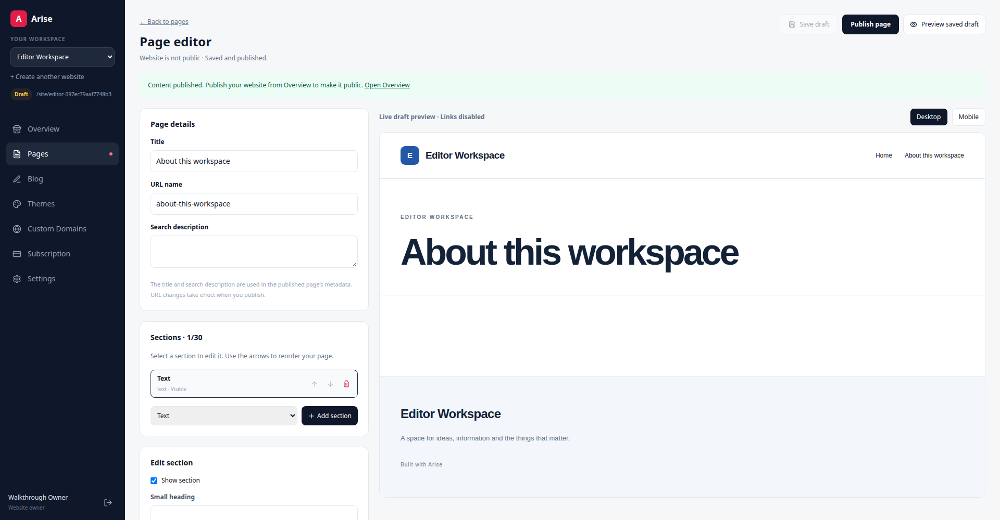

# Fresh-account UI walkthrough

Reviewed the local Docker app on 27 October 2026 (Asia/Dhaka). Existing uncommitted work was preserved. The local API and web containers were rebuilt and restarted with these fixes; no dependencies or migrations were added.

| Reproduced issue | Fix and regression coverage |
|---|---|
| The preview's unfocused “Skip to content” link floated over the dashboard sidebar. | Anchor it above the viewport. Browser checks verify it stays hidden until keyboard focus. |
| After saving, making another edit and clicking “Open Overview” discarded the new edit. | Confirm before client navigation. Cancelling keeps the editor URL and field value. |
| Switching websites could discard unsaved content and change the stored active website before navigation completed. | Confirm before changing the active website. Cancelling preserves both the selected website and edits; accepting opens the destination's page library. |
| Publishing or unpublishing content left the editor's preview navigation stale until a reload. | Refresh preview navigation after publication changes. Browser checks verify links appear and disappear. |
| Duplicate page/post URLs produced a generic error telling users to refresh. | Check URL availability in both creation and saving, and ask for a different URL. API checks verify failed edits preserve saved titles, URLs and revisions. |
| The product image editor rejected same-site paths such as `/uploads/bottle.jpg`. | Allow paths in the editor and validate image URLs using the existing shared server validator. Creation/edit checks cover paths and HTTPS URLs; unsafe schemes, credentials, malformed URLs and empty image entries are rejected. |

The manual browser walkthrough covered marketing and theme browsing, registration, sign-out/sign-in, business-site onboarding, homepage/section/FAQ editing, reordering, private previews, page and website publication, supporting pages, blog publication, theme changes and public contact settings. A second website exercised the store dashboard, categories, products, options, banner text and offers, checkout, tracking, order details, invoices, customer history, reports, invalid-domain feedback and subscription information. Public mobile layout and the editor's mobile preview were inspected. Automated coverage additionally checks every non-store website type and its three themes on desktop and mobile.

The manual fixture remains available in the local account `qa-walkthrough-20261027@example.com`: **QA Studio 20261027** and **QA Store 20261027**. The store's dummy COD order was marked **cancelled** and its note explicitly says not to fulfill it. No existing merchant's content was edited. Automated test accounts are removed by the browser-test cleanup script.

## Verification

- Targeted API checks: **33 passed**.
- Full API suite on SQLite: **119 passed, 1 skipped**.
- Full API suite on PostgreSQL: **120 passed**.
- TypeScript checking and Docker production build: **passed**.
- New browser regressions: **2 passed**.
- Full browser suite: **26 passed, 2 skipped** (opt-in demo-login checks).

Evidence is in [the verification session](../.gravitas/sessions/ui-walkthrough/), including command logs and a patch against the pre-walkthrough source. The first browser attempt could not launch until the required Playwright Chromium binary was installed. Subsequent test-only corrections fixed an early URL capture, a colliding fixture slug and the desktop preview width; these were not product failures.

[Mobile editor screenshot](../.gravitas/sessions/ui-walkthrough/editor-mobile.png).

## Limits

This was a local UI and regression review. Paid billing, live DNS/HTTPS activation, external deployment and load/security audits were not performed. Chrome's native unsaved-edit confirmation required the user to click Cancel during the manual check; cancellation visibly preserved the unsaved text. The automated browser independently verified both cancellation and acceptance behavior.
